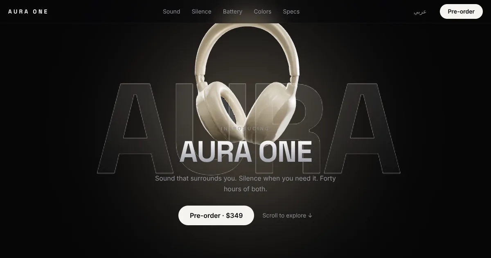

# AURA ONE — 3D Headphones Launch

A premium launch page for wireless headphones, built around a real-time 3D model.

**Live:** [aura-headphones-nu.vercel.app](https://aura-headphones-nu.vercel.app) · Part of my [portfolio](https://aya-khamaysa-portfolio.vercel.app)



## Highlights

- **Scroll-driven 3D:** the headphones glide and turn to present each feature (sound, silence, battery, colors, specs).
- **Live recoloring:** pick a finish and the body changes color instantly, while the speaker cloth stays dark, drawn pixel by pixel in a custom GLSL shader.
- **Drag to spin** the model at any time.
- English / Arabic with a full RTL layout, and a WhatsApp pre-order button.

## Built with

React · Three.js · React Three Fiber · drei · GLSL shaders · Framer Motion · Tailwind CSS · Vite

## Run locally

```bash
npm install
npm run dev
```

## Edit
- Product, price, colors, features and the 3D model file: `src/data/product.js`
- Texts (English / Arabic): `src/data/ui.js`
- The 3D scene: `src/components/Scene3D.jsx` and `src/components/Stage.jsx`

> AURA is a fictional brand for a portfolio concept. The 3D model was generated from a product photo with Hunyuan3D.

---

Designed & built by **Aya Khamaysa** · [Portfolio](https://aya-khamaysa-portfolio.vercel.app) · [LinkedIn](https://www.linkedin.com/in/ayakhamaysa) · [One Click](https://www.instagram.com/oneclick.ps)
